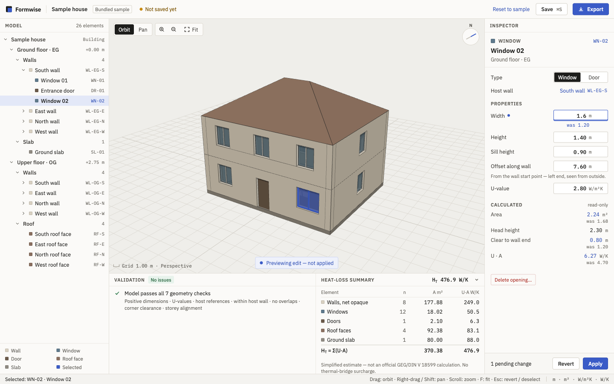

# Formwise

**AI-assisted building reconstruction and renovation modeling — MVP prototype.**

Formwise is a browser-based editor for inspecting a building's 3D envelope, editing walls and openings, and seeing a simplified transmission heat-loss estimate update as you go.

> Formwise is an independent learning/portfolio prototype. It is not a product of, and is not affiliated with, 20° GmbH.



## Run it

Requires Node 20+ and pnpm 10.

```sh
pnpm install
pnpm dev          # http://localhost:5173
```

No backend, account, API key or network service is needed. The bundled sample house loads on start.

| Command | What it does |
| --- | --- |
| `pnpm dev` | Vite dev server |
| `pnpm test` | Vitest unit tests (domain maths, draft editing, exports, persistence parsing) |
| `pnpm typecheck` | `tsc --noEmit`, strict |
| `pnpm lint` | ESLint (typescript-eslint + react-hooks) |
| `pnpm build` | Type-check and production build to `dist/` |

## Demo script (3–5 min)

1. Open the app. The sample house loads; orbit with left-drag, pan with right-drag or Shift, zoom with the wheel, **F** to fit.
2. Click the ground-floor **South wall**. The inspector shows its height, thickness and U-value, plus read-only length, gross/net areas and U·A. These come from the domain model, not from the mesh.
3. Click **Window 02** (in the viewport or the tree). Set **Width** to `2.6`: the edit is rejected ("Extends 0.20 m beyond the end of South wall"), a red ghost shows where it would go, and the model is unchanged.
4. Set **Width** to `1.6` and press **Enter**. The wall is re-cut, and windows area and H_T update.
5. Select the South wall, change **U-value** to `0.24`, Apply. H_T drops by 1.16 W/m²K × 21.48 m² (net, after step 4) = 24.92 W/K.
6. **Add opening** on the wall, then delete it again.
7. **Save** (⌘S / Ctrl+S), reload the page: the model is restored.
8. **Export** glTF + CSV + JSON; the summary totals equal the Heat-loss summary panel.
9. **Export → Project file**, change something, then **Open…** the file: the confirmation shows its contents, and replacing restores it.
10. Show `src/domain/domain.test.ts` and the H_T hand calculation for the sample (476.93 W/K).

## Architecture

```
src/domain/        pure TypeScript — no React, no Three.js
  model.ts         types, coordinate conventions, sample fixture
  geometry.ts      lengths, areas, roof faces, wall outlines, H_T summary
  validate.ts      geometry/property checks, proposeEdit()
src/draft.ts       inspector draft → candidate model, field messages, ghost (pure)
src/store.ts       Zustand store: model, selection, draft, save state
src/scene.ts       domain model → Three.js meshes (the only Z-up → Y-up conversion)
src/Viewport.tsx   renderer, OrbitControls, picking, on-demand rendering
src/App.tsx, Inspector.tsx, BottomPanel.tsx, ExportDialog.tsx   UI
src/persistence.ts localStorage save/load with shape validation
src/export.ts      glTF (GLTFExporter), CSV, JSON
```

Data flow — the domain model is canonical:

1. An inspector edit is stored as a **draft** of raw strings.
2. `evaluateDraft()` parses it and calls `proposeEdit()`, which validates a candidate model.
3. If it is valid, the viewport previews the candidate. On **Apply**, the candidate becomes the model. An invalid edit is never committed.
4. The viewport, inspector, validation panel, summary, save and export all derive from that one model.

## How the calculations work

- **Coordinates:** metres, Z-up (+x east, +y north). A wall runs `start → end` along its exterior face; its thickness extends inward. Openings are stored relative to their host wall (`offset` along the wall from its start, `sillHeight` from its base), so they move with the wall.
- **Wall cutouts:** `wallOutline()` builds the wall's elevation polygon. Openings touching the base (doors) or the top become notches; others become holes. It is extruded through the thickness. There is no general Boolean engine, and openings that fail validation are skipped, so the wall stays closed.
- **Areas:** wall gross = length × height. Net opaque = gross − openings on it. Opening = width × height. Roof face = 3D polygon area of the hipped roof (30°). Slab = ground-storey footprint.
- **Heat loss:** `H_T = Σ(U_i × A_i)` over net opaque walls, openings, roof faces and slab. Openings are counted once, on their own U-value. **Simplified estimate, not an official GEG/DIN V 18599 calculation; no thermal-bridge surcharge.**
- **Validation:** positive dimensions, U-value in 0.01–10 W/m²K, missing host wall, opening beyond the wall ends or above the wall top, overlapping openings (errors); opening edge inside the corner zone, storey heights that don't meet (warnings).

## Implemented vs. simplified vs. out of scope

| | |
| --- | --- |
| **Implemented** | One deterministic two-storey fixture; orbit/pan/zoom/fit; hover + selection from viewport and tree; inspector edits for walls, openings, roof faces, slab; add/delete openings with real wall cutouts; validation panel (click to select); H_T summary; save/reload; open project file; glTF/CSV/JSON/project export |
| **Simplified** | Persistence is **this browser's localStorage only**: it survives reloads, not other browsers or devices, and there is no backend yet. Roof geometry is derived (hipped, ridge along x) and only its thickness/U-value are editable. Wall endpoints and footprint are not editable. |
| **Not built (future)** | CityJSON/LOD2 import (in progress), facade-photo window detection, IFC export, undo/redo, 2D plan view, multi-user editing, certified energy calculations |

## Opening files

**Open…** accepts **Formwise project files only** (`.formwise.json`, written by Export → Project file). Every file passes these checks in order, and the first failure is shown in the Open dialog:

| Check | Rule |
| --- | --- |
| Extension | name ends in `.json` |
| MIME type | empty (unknown) or `application/json` / `text/json` |
| Size | 1 byte – **1 MB** (1,048,576 bytes), checked before the file is read |
| Encoding | strict UTF-8 (invalid bytes are rejected, not replaced) |
| Format | JSON object with `"format": "formwise.project"`, `"version": 1` |
| Model | every field present with the right type, element IDs match their keys, storeys exist, 1–2000 elements |

Geometry problems (e.g. an opening past its wall) don't block opening; they are counted in the dialog and listed in the Validation panel. Opening replaces the current model only after you confirm, and nothing is saved until you press Save.

## Inspecting exports

- `formwise-sample-house.glb`: open in <https://gltf-viewer.donmccurdy.com/> or Blender. Nodes are named `<elementId>:<role>`, and `extras` carries `elementId` and `elementType`.
- `…-summary.csv` / `…-summary.json`: one row per element (type, id, storey, area m², U W/m²K, U·A W/K); the TOTAL row / `totals` equal the summary panel.

## Known limitations

- No backend persistence (see `docs/DECISIONS.md`).
- Openings must be rectangular and lie within one wall.
- The roof generator assumes a footprint wider in x than in y (true for the sample).
- The main JS chunk is ~840 KB minified (before gzip), mostly Three.js; not yet code-split.
- Performance has not been measured beyond "responsive on a laptop" for the 26-element sample.
